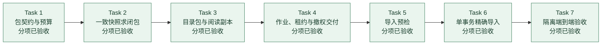
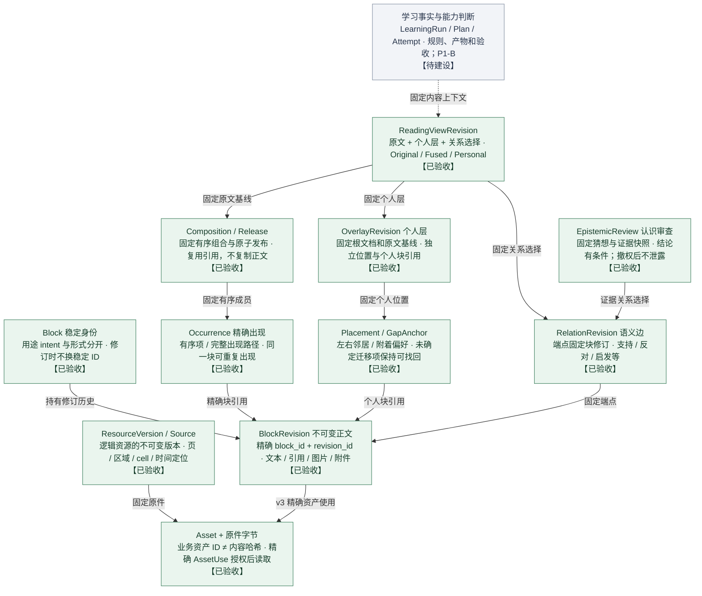
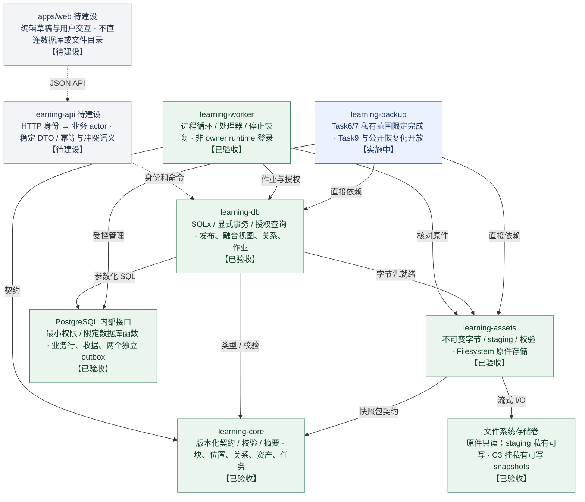
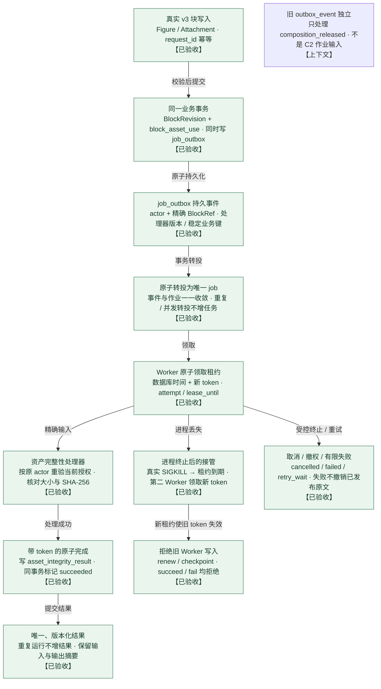
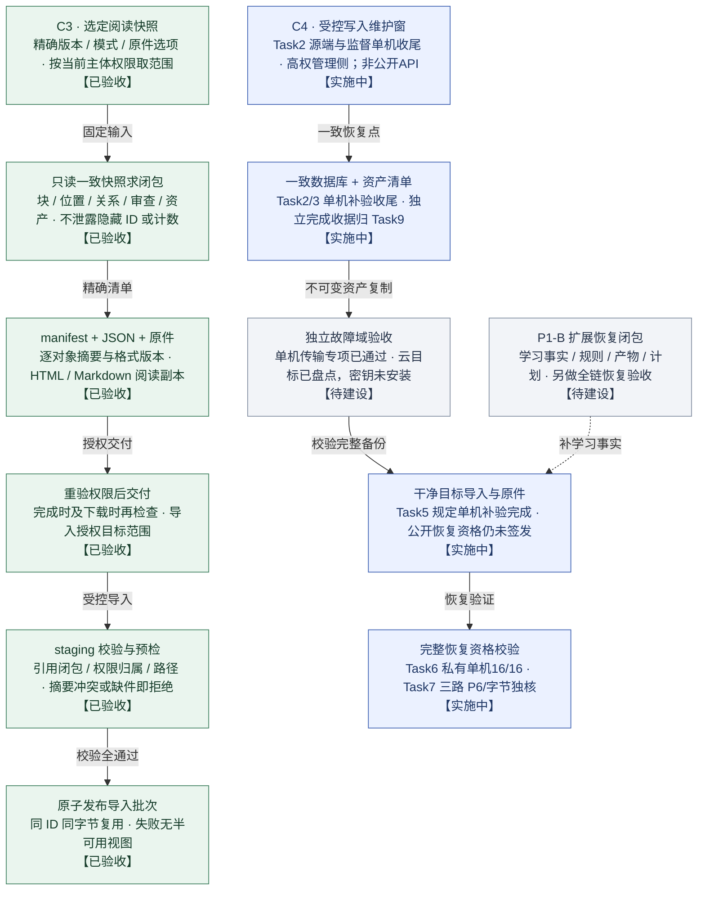
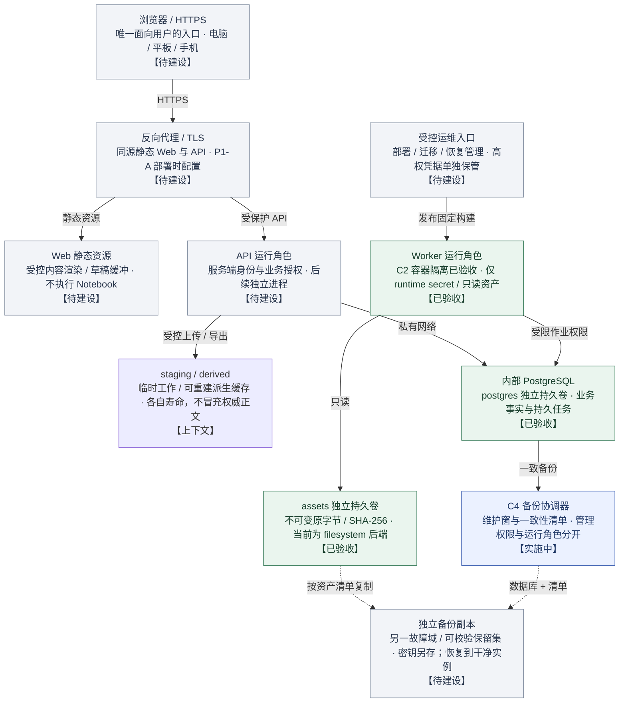

# 知织 · KnowWeave｜实施路线与系统架构

更新：2026-10-26。当前状态：C4实施中 · Task8限定完成 · Task9目标预检与无权限帧准备已完成，`NOT_PRODUCTION`。C3 验收源码 HEAD：`3342c0554c18787749d0f06a772743f867c18720`；当前本地源码检查点：`679b11c3f280546f8d6c20ab15cf7ef59fae3c1a`。各项现场验收保留自己的源码身份，不给最新源码转授历史信用。

面向个人长期学习、支持多领域复用的服务器应用。以可独立修订的块为核心，将原文、笔记、图片、想法与猜想连续编排；版本、位置、关系、证据与学习事实各自留存。

当前状态与目标设计同图展示：P0-A、B1–B4、C1–C3已分关验收；C4代码和规定私有单机补验已完成Task8限定回归收尾，Task9及C4整关仍开放。颜色只表示标注范围，不代表部署。

[离线图文版](../KnowWeave实施路线与架构.html)。此文为可编辑 Markdown 快照；可维护图数据在 [.build/knowweave-map.data.mjs](../.build/knowweave-map.data.mjs)，生成命令为 `node .build/build-knowweave-map.mjs`。

## 实施路线

P0-A、B1–B4、C1–C3 共 8 个分关已验收。已选独立云目标，既有SSH元数据及普通账户FS六项预检通过，用户选择目标root托管方案。新增独立Rust帧准备文件不导入产品；Linux格式/编译/列举/20正文通过且原件独核。旧格式失败保留，未增加首签/发布权限或Task9验收信用。

不用分关数量或累加测试数估算整个项目完成百分比；各阶段历史测试数不能相加。

```mermaid
flowchart LR
    M0["P0-A<br/>块修订与权限<br/>已验收"]
    M1["P0-B1<br/>组合与原子发布<br/>已验收"]
    M2["P0-B2<br/>个人层与融合阅读<br/>已验收"]
    M3["P0-B3<br/>关系与认识审查<br/>已验收"]
    M4["P0-B4<br/>读取投影与影响查询<br/>已验收"]
    M5["P0-C1<br/>原件、图片与附件<br/>已验收"]
    M6["P0-C2<br/>持久任务与受限 Worker<br/>已验收"]
    M7["P0-C3<br/>融合快照交换<br/>已验收"]
    M8["P0-C4<br/>完整备份与干净恢复<br/>实施中"]
    M9["P1-A<br/>登录、API 与内容工作台<br/>待建设"]
    M10["P1-B<br/>学习与实践闭环<br/>待建设"]
    M11["P2<br/>批量演进与多领域复用<br/>待建设"]
    M12["P3<br/>按需求增强<br/>可选"]
    M0 --> M1
    M1 --> M2
    M2 --> M3
    M3 --> M4
    M4 --> M5
    M5 --> M6
    M6 --> M7
    M7 --> M8
    M8 --> M9
    M9 --> M10
    M10 --> M11
    M11 --> M12
```



| 阶段 | 状态 | 交付 | 验收门 | 证据或范围 |
| --- | --- | --- | --- | --- |
| P0-A 块修订与权限 | 已验收 | 稳定块身份、不可变修订、当前授权、幂等请求和并发冲突。 | 真实 PostgreSQL 权限、重复写入、冲突与回滚验证。 | [29/29；已验收](https://github.com/MansurnamedZhang/learning-system-p0c4/blob/addf1193c98e18c6eadb548ed635c35eaff95707/docs/p0a-verification.md) |
| P0-B1 组合与原子发布 | 已验收 | 固定组合、重复出现的独立 occurrence、精确版本引用及原子发布。 | 两文档复用一个块；只升级指定组合；旧发布仍可复现。 | [68/68；已验收](https://github.com/MansurnamedZhang/learning-system-p0c4/blob/addf1193c98e18c6eadb548ed635c35eaff95707/docs/p0b1-verification.md) |
| P0-B2 个人层与融合阅读 | 已验收 | 间隙插入、个人位置、原文/融合/个人投影及固定阅读修订。 | 位置与正文同步保存；移动不改原文；无法迁移的内容可找回。 | [105/105；已验收](https://github.com/MansurnamedZhang/learning-system-p0c4/blob/addf1193c98e18c6eadb548ed635c35eaff95707/docs/p0b2-verification.md) |
| P0-B3 关系与认识审查 | 已验收 | 支持/反对等关系、猜想版本与证据判断、派生/拆分/合并谱系。 | 隐藏证据不泄露；猜想新版不自动继承旧判断。 | [222/222；已验收](https://github.com/MansurnamedZhang/learning-system-p0c4/blob/addf1193c98e18c6eadb548ed635c35eaff95707/docs/p0b3-verification.md) |
| P0-B4 读取投影与影响查询 | 已验收 | 固定范围反向引用、关系遍历、解释路径与有界查询。 | 按当前权限过滤；隐藏桥不扩展；截断和失败明确区分。 | [284 通过 / 3 忽略；已验收](https://github.com/MansurnamedZhang/learning-system-p0c4/blob/addf1193c98e18c6eadb548ed635c35eaff95707/docs/p0b4-verification.md) |
| P0-C1 原件、图片与附件 | 已验收 | 不可变原字节、资源版本定位、v3 图片/附件及精确使用授权。 | 独立卷原字节核验；中断/损坏/回滚/撤权；四套旧程序升级。 | [328 通过 / 3 忽略；已验收](https://github.com/MansurnamedZhang/learning-system-p0c4/blob/addf1193c98e18c6eadb548ed635c35eaff95707/docs/p0c1-verification.md) |
| P0-C2 持久任务与受限 Worker | 已验收 | 同事务事件、持久转投、数据库租约、有限重试、资产完整性处理器。 | 专用 Worker 真 SIGKILL/接管/取消/撤权；旧 token 拒绝；唯一结果。 | [388 通过 / 0 失败 / 3 忽略；965 份证据哈希一致](https://github.com/MansurnamedZhang/learning-system-p0c4/blob/addf1193c98e18c6eadb548ed635c35eaff95707/docs/p0c2-verification.md) |
| P0-C3 融合快照交换 | 已验收 | 精确 Reading 快照、版本化目录包与可选原件；导入前校验、原子可见。 | 授权闭包往返；缺件/篡改/撤权/同 ID 不同字节拒绝；不出现半可见视图。 | [整关隔离验收与 602 份证据哈希复核通过；未生产部署](https://github.com/MansurnamedZhang/learning-system-p0c4/blob/addf1193c98e18c6eadb548ed635c35eaff95707/docs/p0c3-verification.md) |
| P0-C4 完整备份与干净恢复 | 实施中 | 受控写入维护窗、数据库一致性备份、资产闭包、异机副本、干净实例恢复。 | 固定历史、个人间隙、关系/审查、权限与原件一致；残缺备份不得标 complete。 | [Task5限定收尾；Task6私有16/16；Task7私有6/6；Task8限定完成；Task9与整关OPEN](../docs/p0c4-completion-acceptance.md) |
| P1-A 登录、API 与内容工作台 | 待建设 | HTTP 身份/会话、稳定 DTO、连续阅读、块编辑、插入图片笔记与历史冲突处理。 | 真实浏览器端到端；跨设备读取服务端保存；冲突保留草稿；HTTP/资产授权。 | [待建设；首次形成浏览器内容工作台](../docs/设计批准与实施路线.md) |
| P1-B 学习与实践闭环 | 待建设 | 学习单元、计划、任务、尝试、产物、验收、复习；接入首批真实资料。 | 今日任务→阅读实践→提交产物→条件化验收；关闭 AI 仍可用；补学习事实恢复。 | [待建设；通过后形成完整学习系统试用版](../docs/学习系统设计方案.md) |
| P2 批量演进与多领域复用 | 待建设 | 批量内容升级、迁移候选处理、第二领域、规则推荐与计划调整。 | 真实资料更新保留旧事实；第二领域不新增专属核心业务流程。 | [待建设](../docs/学习系统设计方案.md) |
| P3 按需求增强 | 可选 | AI 辅助、OCR/预览等解析器、语义检索；独立评估 S3 和 Neo4j 可重建投影。 | 来源/版本可追溯、权限不绕过、失败可降级；按测量结果决定引入。 | [可选增强；不是首版必装组件](../docs/数据库选型实验审阅与首版决策.md) |

## 下一步

当前阻断转为B1：原manager可信身份、源死亡与最终决策、P一次消费及UNKNOWN规则待裁决。key/trust/registry/构建pin与管理身份未安装，未执行正常CompleteBackup或恢复；正式五门和C4仍OPEN。

- **01 · 裁决B1身份和最终消费规则**：原manager身份不能靠SSH账号或自报build；最后消息/心跳不能证明S持续活性；旧finalize_use不是one-shot。
- **02 · 再实现并审查权限接入**：现阶段只允许独立无权限帧准备；具体契约采纳后才接原S/D/C/P与v2 writer，保持旧拒绝入口。
- **03 · 准确审批安装与真实整链**：key/trust/registry/构建pin与管理身份分项批准；D1正常恢复、D2源隔离另设停止点，保留原件，不合并main或部署生产。

## 当前阶段 C4：九任务补齐计划

任务编号依据 [2026-10-04 补齐计划](https://github.com/MansurnamedZhang/learning-system-p0c4/blob/addf1193c98e18c6eadb548ed635c35eaff95707/docs/superpowers/plans/2026-10-04-p0c4-completion.md)，与下面原五任务父里程碑分开。分项通过不关闭父里程碑或 C4。

已选独立云目标，既有SSH元数据及普通账户FS六项预检通过，用户选择目标root托管方案。新增独立Rust帧准备文件不导入产品；Linux格式/编译/列举/20正文通过且原件独核。旧格式失败保留，未增加首签/发布权限或Task9验收信用。

当前阻断转为B1：原manager可信身份、源死亡与最终决策、P一次消费及UNKNOWN规则待裁决。key/trust/registry/构建pin与管理身份未安装，未执行正常CompleteBackup或恢复；正式五门和C4仍OPEN。

全部规定专项的有限原件、来源、实际正文与精确资源收尾已限定采用；所有旧失败/HOLD保持。生命周期真实13,094日志经独审后的16k读取配方完整导出13,099文件，512MiB读/输出、32MiB单件、300/360秒与资源等式不变。Full9大negative、部分最终proof与Schema未选output、ELF/inspect/独立OS时钟等层级限制继续披露，不宣称所有物理状态或正常恢复均已外部证明。

```mermaid
flowchart LR
    C4T1["Task 1<br/>持久登记与原件保护<br/>限定分项已验收"]
    C4T2["Task 2<br/>精确源端绑定与捕获监督<br/>代码与单机补验收尾完成"]
    C4T3["Task 3<br/>保留校验与完成收据<br/>单机补验收尾完成，Task9开放"]
    C4T4["Task 4<br/>全量模式与有界 COPY 数据<br/>内容范围3/3通过"]
    C4T5["Task 5<br/>受控整库导入与原件恢复<br/>代码与规定单机补验限定完成"]
    C4T6["Task 6<br/>作业归一化与恢复资格校验<br/>私有单机16/16限定完成"]
    C4T7["Task 7<br/>完整 Attention 链与负例<br/>私有单机6/6原件限定关闭"]
    C4T8["Task 8<br/>当前回归、旧版升级与审查<br/>私有单机范围限定验收"]
    C4T9["Task 9<br/>真实独立故障域闭合<br/>目标预检/帧准备完成，B1权限待裁决"]
    C4T1 --> C4T2
    C4T2 --> C4T3
    C4T3 --> C4T4
    C4T4 --> C4T5
    C4T5 --> C4T6
    C4T6 --> C4T7
    C4T7 --> C4T8
    C4T8 --> C4T9
    class C4T1,C4T2,C4T3,C4T4,C4T5,C4T6,C4T7,C4T8 done
    class C4T9 next
    classDef done fill:#eaf5ee,stroke:#438363,color:#173d2b
    classDef next fill:#ebf1ff,stroke:#4365b4,color:#203866
    classDef planned fill:#f2f4f8,stroke:#8591a3,color:#28354b
```



| 任务 | 状态 | 工作与验收依据 |
| --- | --- | --- |
| Task 1 · 持久登记与原件保护 | 限定分项已验收 | 登记资产与本地 pin 根身份；独立发现保留保护，缺失或不完整时拒绝清理候选。 固定 Linux/PG 登记保护门 11/11 与五项文件系统门通过；本任务不签发完整备份，也不关闭 C4。 |
| Task 2 · 精确源端绑定与捕获监督 | 代码与单机补验收尾完成 | 历史ba96561同包准入5/5、绑定4+2、新端点5/5及fresh life8/8已分别独审接受。 同包准入5/5、绑定4+2、新端点5/5和fresh life8/8分别独审采用。历史UNKNOWN和失败仍保留；当前源码全量回归归Task8。 |
| Task 3 · 保留校验与完成收据 | 单机补验收尾完成，Task9开放 | 校验封存包和保留集；真实首签与新发布入口默认关闭，跨操作权限、独立目标和密钥托管归Task9。 当前Windows16项与Linux默认20/特性配置6项分别通过；629原件、17执行记录、539源码与8编译角色关联已核对，单机补验收尾。8个相关Git blob同已验版本；历史E8两项Linux目标文件校验/中断传输已核验，属于合成历史分项，未签发真实完成收据。不同源码/平台分别留证，不用可见残留推导CompleteBackup。 |
| Task 4 · 全量模式与有界 COPY 数据 | 内容范围3/3通过 | 完整审查模式、固定客户端/TOC 与有界 COPY 字节；函数/ACL 篡改拒绝，数据中的 SQL 外观不变成命令。 只关闭模式/TOC/COPY内容三门，不授予整库恢复资格；最终当前源码回归归Task8。 |
| Task 5 · 受控整库导入与原件恢复 | 代码与规定单机补验限定完成 | 受控整库导入、提交前拒绝、取消与未知提交结果、角色/路由/目标/原件检查，按各次固定源码和实际回执分别留证。 2026-10-20 Root限定采用：85c九项native及最终Linux回归；受控11/11为10历史c749＋1当前85c，不能称当前源码新跑11项。旧失败与HOLD保留。 |
| Task 6 · 作业归一化与恢复资格校验 | 私有单机16/16限定完成 | 恢复后全表校验、任务归一化、旧租约/token失效、快照写入与效果证明；无法确认的外部副作用保留Unknown/HOLD。 2026-10-24采用2e5026d：五项恢复基础＋十一项快照场景，每项1 passed/0 failed/0 ignored，含core/P6原件独核。该历史范围不等于当前源码Task8回归或公开恢复资格。 |
| Task 7 · 完整 Attention 链与负例 | 私有单机6/6原件限定关闭 | Attention完整正例、缺失原件、损坏dump、传输中断、未知外部效果、原件根替换六案，按各自预期阶段采用。 2026-10-25 Root采用36c89f2；此前3项＋新3项，六案Core/Proof与三个good-pin场景P6及实际ReadingCopy字节独核。仅规定私有单机夹具，不签发CompleteBackup/RecoveredInstance。 |
| Task 8 · 当前回归、旧版升级与审查 | 私有单机范围限定验收 | Task8已按规定私有单机范围完成：A5完整Linux/PG18十门、四套真实旧版升级、54项fresh专项（53项A5＋1项Source679）、6项未变历史桥及整组独审。RootFS33与生命周期FS5单列；各源码与证明层级分别记账。 全部规定专项的有限原件、来源、实际正文与精确资源收尾已限定采用；所有旧失败/HOLD保持。生命周期真实13,094日志经独审后的16k读取配方完整导出13,099文件，512MiB读/输出、32MiB单件、300/360秒与资源等式不变。Full9大negative、部分最终proof与Schema未选output、ELF/inspect/独立OS时钟等层级限制继续披露，不宣称所有物理状态或正常恢复均已外部证明。 169 ignored已具名处置，不等于169全部运行；65 extra与3 measurement未执行披露。 |
| Task 9 · 真实独立故障域闭合 | 目标预检/帧准备完成，B1权限待裁决 | 云目标与托管方案已选，普通FS六项及Linux无权限parser20正文通过；不是root安装、B1首签/发布或正常恢复。 FS6保留原件与Root同会话回读；Rust单文件格式/编译/列举/20正文通过，另一子代理独核日志和binary摘要。旧format失败保留；37集成及正式五门未完成。 |

### 原五任务父里程碑（保留原编号）

对应 [2026-09-28 父计划](https://github.com/MansurnamedZhang/learning-system-p0c4/blob/addf1193c98e18c6eadb548ed635c35eaff95707/docs/superpowers/plans/2026-09-28-p0c4-backup-recovery.md)，下表不是当前九任务的编号或完成计数。原 Task3–5 的完整门继续开放。

| 父里程碑 | 状态 | 工作与当前边界 |
| --- | --- | --- |
| 原 Task 1 · 全量备份契约与资产清单 | 分项已验收 | 版本化 manifest、规范摘要与全部 ready 资产目录；规划不冒充完成备份。 独立复审及全新 PG18 专项通过，含普通角色拒绝；C4 整关未验收。 |
| 原 Task 2 · 安全封存与目标端校验 | 分项已验收 | 私有 staging、流式复制核哈希、no-follow 与封存；中断不发布可恢复包。 Linux 专项及 SIGKILL/部分写入故障门通过；同步故障使用测试钩子，非真实掉电证明。 |
| 原 Task 3 · 维护窗与一致性数据库备份 | 实施中 | 受控写闸、在途排空、一致 dump 与资产清单；由补齐计划Task1–3继续完成。 源端与单机保留/传输补验已收尾；真实独立目标、完成收据与发布权限仍归Task9，父里程碑保持开放。 |
| 原 Task 4 · 干净实例恢复 | 实施中 | 目标准入、出生证明、精确端点绑定与完整导入；由补齐计划Task4–6继续完成。 Task4内容、Task5受控导入、Task6私有16/16及Task8规定回归均有分项证据；正常公开恢复资格仍待Task9，父里程碑保持开放。 |
| 原 Task 5 · 完整场景与故障注入验收 | 实施中 | 完整 Attention、当前完整回归、四套旧版升级与整分支审查；由补齐计划Task7–9闭合。 Task7私有六案及Task8完整回归/四升级/规定专项/整组审查已限定关闭；Task9独立故障域与正常整链尚未满足，父里程碑保持开放。 |

## C3 历史：七任务实施线

Task 1–7 已完成分项审查与隔离验证；Task 7 的完整 Linux/PostgreSQL/Worker 证据经 root 私有只读审计复核，C3 标记为 `P0_C3_VERIFIED / NOT_PRODUCTION`。



| 任务 | 状态 | 工作与验收依据 |
| --- | --- | --- |
| Task 1 · 包契约与预算 | 分项已验收 | 版本化 manifest、精确对象身份与摘要、阅读副本隔离、封闭预算。 代码与独立复审完成；最终纳入 C3 整关验收。 |
| Task 2 · 一致快照求闭包 | 分项已验收 | 在单个只读事务中固定 Reading、引用、关系、审查和资产使用，并按当前授权过滤。 全新隔离 PostgreSQL：专项 9/9、相关回归 15/15。 |
| Task 3 · 目录包与阅读副本 | 分项已验收 | 私有 staging、流式核哈希、Linux no-follow 与受控句柄交付；阅读副本去身份化。 独立复审通过；全新隔离 Linux 专项 38/38。 |
| Task 4 · 作业、租约与撤权交付 | 分项已验收 | 追加 C3 作业类型与迁移；复用租约 fencing，完成和交付时重新核验授权。 独立复审通过；全新隔离 PostgreSQL 专项 18/18、C2 回归 39/39、Worker 11 项及 0013→0014 升级通过；修复已并入主工作树。 |
| Task 5 · 导入预检 | 分项已验收 | 校验版本、路径、摘要、身份冲突、引用闭包及目标资产存在性。 夹具修复后独立复审通过；全新隔离项目 Task 5 12/12，相关回归合计 86 项、格式/严格 Clippy 通过。 |
| Task 6 · 单事务精确导入 | 分项已验收 | 同 ID 同字节幂等复用，冲突拒绝；结果原子可见且可追溯。 第三轮新隔离 PostgreSQL 专项 3/3、指定回归与 fmt/严格 Clippy 通过；旧夹具失败和缺冻结清单的 101 均保留证据。 |
| Task 7 · 隔离端到端验收 | 分项已验收 | 完整往返、故障注入、撤权、旧版升级、全工作区与独立复审。 全量 result SHA c939cc71…；602 份证据哈希一致；整关已验收，未生产部署。 |

## 全局约束

- **权威分层**：PostgreSQL 是结构化业务权威；assets 是原字节权威；派生缓存、导出阅读副本和未来 Neo4j 投影均可重建或重新生成。
- **版本不漂移**：Block 稳定 ID、修订 ID、组合发布、个人层、关系选择与学习快照分别留存。更新产生候选；是否采用新版由明确操作决定。
- **授权贯穿链路**：正文、必要引用、位置、关系、影响路径和精确资产使用都核对当前权限；HTTP、搜索与导出必须在后续阶段继承并另验此语义。
- **知识证据与学习证据分开**：支持/反对关系和认识审查已有内核；学习任务、尝试、产物、评分规则、能力验收尚属 P1-B。阅读完成不会自动成为通过。
- **模块化单体**：crate 分职责，API 与 Worker 可分进程；首版无需 Kafka、Redis、Kubernetes、向量数据库或常驻 Neo4j。
- **生产状态诚实**：历史分关、当前源码前置、规定私有单机验收、公开恢复资格和生产部署分别标注。Task6/7有限范围完成；Task8限定完成；Task9与C4整关开放。P1产品入口尚未实施，GitHub候选分支更新不代表main合并或部署。

## 01 · 全系统架构总览

模块化单体目标架构：业务契约与现有后端内核已实现；HTTP/API和Web产品入口待P1建设。

[独立矢量图](diagrams/knowweave-overview.svg) · [Mermaid 源码](diagrams/knowweave-overview.mmd)

```mermaid
flowchart TB
    user["个人学习者<br/>电脑 / 平板 / 手机 · 跨设备访问同一服务<br/>【上下文】"]
    web["Web 学习工作台<br/>阅读 · 编辑 · 图谱 · 今日 · P1-A / P1-B 待建设<br/>【待建设】"]
    sources["课程与实践来源<br/>PDF / PPTX / Notebook / 代码 · 原格式资料与实验产物<br/>【上下文】"]
    learning["学习与计划模块<br/>单元 / 任务 / 尝试 / 验收 · P1-B；规则推荐延伸到 P2<br/>【待建设】"]
    api["Rust HTTP / 身份边界<br/>会话 · DTO · 授权入口 · P1-A；Axum 为建议<br/>【待建设】"]
    import["交换与导入入口<br/>C3 快照已验收；资料入口待建 · 批量更新属于后续阶段<br/>【实施中】"]
    content["内容与关系内核<br/>块 / 组合 / 个人层 / 审查 · P0-A / B1–B4 已验收<br/>【已验收】"]
    jobs["持久任务与 Worker<br/>job_outbox → job → 租约 · C2 资产完整性已验收<br/>【已验收】"]
    assetapi["资产与来源模块<br/>资源版本 · 精确使用授权 · C1 原字节与 v3 图片/附件<br/>【已验收】"]
    pg["PostgreSQL 权威库<br/>结构化正文与关系 / 作业状态 · SQLx · 事务 · 追加迁移<br/>【已验收】"]
    derived["可重建派生层<br/>预览 / OCR / 搜索 / 检索片段 · 处理器与索引后续按需建设<br/>【可选】"]
    files["不可变原件库<br/>SHA-256 原件 · 独立持久卷 · 独立卷不等于独立故障域<br/>【已验收】"]
    portable["C3 / C4 可移植性<br/>Task6/7 私有单机限定完成 · Task9 与 C4 整关开放<br/>【实施中】"]
    graph["Neo4j 可选投影<br/>首版不常驻 · 来源仍为 PostgreSQL<br/>【可选】"]
    ai["可选 AI / 外部执行<br/>仅建议；实验默认外部运行 · 关闭后不影响核心流程<br/>【可选】"]
    user -- "访问" --> web
    web -- "同源 API" --> api
    sources -- "登记 / 受控导入" --> import
    api -- "业务调用" --> learning
    api -- "校验与编排" --> content
    import -- "原件与引用" --> assetapi
    content -- "事务读写" --> pg
    assetapi -- "校验 / 定稿 / 授权读取" --> files
    assetapi -- "元数据 / 精确使用 / 授权" --> pg
    learning -. "学习事实" .-> pg
    jobs -- "转投 / 租约 / 结果" --> pg
    jobs -- "复用精确授权" --> assetapi
    jobs -. "未来处理器" .-> derived
    files -- "原字节闭包" --> portable
    pg -- "闭包与一致快照" --> portable
    pg -. "可重建投影" .-> graph
    derived -. "按需适配" .-> ai
    class content,jobs,assetapi,pg,files done
    class import,portable next
    class web,learning,api planned
    class derived,graph,ai optional
    classDef done fill:#eaf5ee,stroke:#438363,color:#173d2b
    classDef next fill:#ebf1ff,stroke:#4365b4,color:#203866
    classDef planned fill:#f2f4f8,stroke:#8591a3,color:#28354b
    classDef optional fill:#f3ecfb,stroke:#9271b0,color:#4a3362
```

- 浏览器工作台、HTTP 登录和学习闭环均为待建设。React + TypeScript + Vite、Axum 是建议组合，尚未作为已实施依赖固化。
- PostgreSQL 保存身份、修订、权限、位置、关系和任务状态；文件卷保存不可变原件。JSON/Markdown/HTML 是交换或阅读副本。
- 知识关系图由 PostgreSQL 数据构建；Neo4j 如以后采用，只作为可重建投影。AI 不决定权威知识和验收事实。
- C4恢复管理代码与单机补验已推进至Task8限定收尾；Task9和独立完成收据仍开放，不能将单机ReadingCopy交付称为生产服务。

## 02 · 块、位置与版本关系

箭头统一由持有者或引用者指向目标；省略部分约束字段，不把对象画成独立服务。

[独立矢量图](diagrams/knowweave-domain.svg) · [Mermaid 源码](diagrams/knowweave-domain.mmd)



- 稳定 ID 与不可变修订 ID 分开；正式发布和阅读快照固定修订，不随 head 自动漂移。相同字节哈希也不会自动合并业务身份。
- 一次出现由 occurrence 或 placement 标识；正文修订与位置移动是不同操作。个人层固定原文基线，不改写原文。
- 关系/认识审查属于已实现的知识证据内核；学习任务的尝试、产物与能力验收属于未来 P1-B，不能混为已完成。
- 当前正文支持 v1 文本、v2 文本/块引用/关系视图、v3 图片/附件。独立公式、代码、表格、练习、评分规则等更多类型仍需各自契约与验收。

## 03 · Rust 代码与授权边界

实线显示现有模块依赖与运行接口；虚线表示未来接入。crate 是代码模块，不是独立网络服务。

[独立矢量图](diagrams/knowweave-crates.svg) · [Mermaid 源码](diagrams/knowweave-crates.mmd)



- 当前a5eb28d Cargo workspace有core、assets、db、worker、backup五个crate。真实直接依赖：backup → db/assets/core；worker → db/assets/core；db → assets/core；assets → core。assets不负责业务actor授权。API与Web尚未加入workspace。
- Worker 原件与二进制只读，staging 私有可写；C3 另挂服务所有的私有可写 snapshots 卷，管理凭据不进入普通 Worker。
- 数据库 runtime 是可信内部服务角色，非每位最终用户或每个 Worker 的独立数据库租户。用户权限由业务 actor、当前空间授权和必要引用闭包共同判定。
- 两项 P2 契约缺口已记录：持当前 token 的共享 runtime 可调用通用 succeed 而不写专用结果；也可直接调用完成函数绕过 Rust 字节复核。正常 Worker 已验收路径使用原子结果函数。这里 P2 是问题优先级，不表示已安排在路线 P2 阶段。
- 旧 outbox_event 只保存 composition_released，C2 的 job_outbox / job 是独立协议；图与实现均不把两者合并成一张通用队列表。
- 图省略backup→core直接连线以保持可读，代码依赖以Cargo.toml为准。

## 04 · 持久任务与真实故障恢复

C2 已验收路径：新事件来自精确 v3 块资产使用，采用至少一次执行与幂等结果。

[独立矢量图](diagrams/knowweave-jobs.svg) · [Mermaid 源码](diagrams/knowweave-jobs.mmd)



- 仅登记资产、仅关联资源版本或旧发布 outbox，不会自动创建这类资产检查任务。正文和事件同事务提交；旧请求收据重放不增事件。
- claim 使用 PostgreSQL 时钟和数据库生成 token。续租、检查点、成功和失败都校验当前 token；最多三次尝试，取消与终态不复活。
- 专用 Worker 只挂 runtime secret、只读资产与只读二进制；真实 SIGKILL 后第二 Worker 接管 attempt 2，旧 token 的四种写入均被拒绝。
- 完整性处理只核大小、SHA-256 与轻量元信息，不宣称已实现预览、OCR、完整媒体解析或恶意文件扫描。
- C4 Task6/7恢复时会使旧租约/token失效，对已提交效果、确认无效果与未知效果分别处理；Unknown/HOLD不会自动变成可运行。其证据范围限规定私有单机场景。

## 05 · C3 交换与 C4 恢复

C3范围快照交换已验收；C4单机链已完成Task8限定回归与审查；Task9独立域和正常公开恢复仍待完成。

[独立矢量图](diagrams/knowweave-portability.svg) · [Mermaid 源码](diagrams/knowweave-portability.mmd)



- C3 Task 1–7 已完成分项与整关隔离验收：Task 7 在全新 Compose 项目通过完整 workspace、四套旧版升级、真实 Worker SIGKILL/租约接管、双端往返和四组失败注入。独立 root 只读审计核验 602 份证据文件、341 个源码文件、301 项镜像输入；状态为 P0_C3_VERIFIED / NOT_PRODUCTION。
- C3 输入为精确 ReadingViewRevision、模式和原件选项；当前授权求闭包，作业结束与交付时再次检查。已下载的文件无法被服务器远程撤回。
- 无损交换以版本化 JSON 与 manifest 为准；HTML/Markdown 是阅读副本。导入同 ID 同字节幂等复用，不同字节拒绝。
- C4 Task2/3/5分别在原固定源码上完成规定单机补验；Task4只覆盖内容三门。Task6的2e5026d私有16/16与Task7的36c89f2私有6/6分别留证，不作为当前全工作区或四套升级通过。
- Task7六案：完整正例、缺失原件、损坏dump、传输中断、未知效果、原件根替换。未知效果在导入后拒绝并留3项UNKNOWN/runnable0；不是导入前目标不变。根替换只声明列举catalog/assets/attempt字节不变，不声明整个文件系统不变。
- 三个good-pin恢复路径各四份ReadingCopy文件共1172B，四处逐字相等且inode独立；它们位于同一主机，不构成独立故障域。失败53df不计通过，历史未观测的外层OS收据不补造。
- Task8规定私有回归及整组审查已限定完成。Task9仍须以真实独立目标、托管密钥及首签/新发布权限集成完成正常CompleteBackup与源端不可访问恢复；C4整关保持开放。
- 未来P1-B新增学习任务、尝试、产物、验收与计划历史后，须同步扩展恢复闭包并另验整链。

## 06 · 目标部署与存储边界

目标为私有单机 Linux + Compose。现有证明来自隔离验收环境，未部署成生产服务。

[独立矢量图](diagrams/knowweave-deployment.svg) · [Mermaid 源码](diagrams/knowweave-deployment.mmd)



- C4 源控制根绑定已在单可信容器命名空间实测；独立签发/每部署编译 pin 不构成宿主生产安装流程，独立存储故障域仍延后。
- 只有 HTTPS 入口面向浏览器；数据库、文件卷和高权管理入口不直接公开。API 与 Worker 复用业务代码而采用不同运行职责。
- C2 专用 Worker 容器以非 root 运行、只读根文件系统、私有 tmpfs，限制资源；管理 secret 不在 Worker 文件系统中。宿主 root / Docker daemon 仍属于可信管理边界。
- assets 是权威原字节；staging 是未完成工作；derived 是可重建派生物；验收 evidence 保存此次测试证据，并不等于将来学习产物的数据库模型。
- 生产部署前重新核对服务器时钟、runtime配置、HTTP授权、已记录的内部runtime契约缺口、日志/容量/升级/备份策略。当前没有本轮生产时钟或服务健康实测，不将历史故障写成实时状态。

## 状态依据

- [架构设计文档集（设计参考，状态以本图为准）](../docs/KnowWeave架构设计总览.md)
- [批准记录与阶段边界](../docs/设计批准与实施路线.md)
- [总体设计](../docs/学习系统设计方案.md)
- [块与存储规范](../docs/内容分块与存储规范.md)
- [连续阅读与思考块](../docs/连续阅读与思考块设计.md)
- [当前Task7验收与范围](../docs/p0c4-completion-acceptance.md)
- [Task8当前回归与待验边界](../docs/p0c4-task8-current-regression.md)
- [本轮全路线审核记录](../docs/路线图更新审核记录-2026-10-25.md)
- [Task2/3/5历史补验台账](https://github.com/MansurnamedZhang/learning-system-p0c4/blob/addf1193c98e18c6eadb548ed635c35eaff95707/docs/P0-C4补验与收尾.md)
- [Task6历史采用与项目进度](https://github.com/MansurnamedZhang/learning-system-p0c4/blob/addf1193c98e18c6eadb548ed635c35eaff95707/docs/项目最新进度.md)
- [C4九任务补齐施工单](https://github.com/MansurnamedZhang/learning-system-p0c4/blob/addf1193c98e18c6eadb548ed635c35eaff95707/docs/superpowers/plans/2026-10-04-p0c4-completion.md)
- [C4补齐设计](https://github.com/MansurnamedZhang/learning-system-p0c4/blob/addf1193c98e18c6eadb548ed635c35eaff95707/docs/superpowers/specs/2026-10-04-p0c4-completion-design.md)
- [C4原五任务父计划](https://github.com/MansurnamedZhang/learning-system-p0c4/blob/addf1193c98e18c6eadb548ed635c35eaff95707/docs/superpowers/plans/2026-09-28-p0c4-backup-recovery.md)
- [C3整关验证台账](https://github.com/MansurnamedZhang/learning-system-p0c4/blob/addf1193c98e18c6eadb548ed635c35eaff95707/docs/p0c3-verification.md)
- [当前任务源码workspace](https://github.com/MansurnamedZhang/learning-system-p0c4/tree/feat/task7-attention-recovery)
- [Neo4j首版决策](../docs/数据库选型实验审阅与首版决策.md)
- [Task9准备、授权缺口与最小审批边界](../docs/p0c4-task9-readiness.md)
- [B1最小集成与失败测试草案](../docs/superpowers/specs/2026-10-26-task9-b1-integration-preparation.md)
- [37条Task9集成测试规格（未执行）](../docs/task9/b1-preparation-test-matrix.json)
- [Task9本地准备收尾、导出复用与剩余阻碍](../docs/task9/local-preparation-closeout.md)
- [Task9目标事实、最小审批与八步执行准备单](../docs/task9/execution-readiness.md)
- [Task9已选目标、FS预检与Linux帧准备原件](../docs/task9/selected-target-preparation.md)
- [Task9异机活操作RFC与待裁决权限](../docs/task9/b1-offhost-admission-rfc.md)

### 历史证据的范围

各历史来源、失败UUID、HOLD与未观测字段保留，不将旧失败改写为通过，不重放旧资源，也不把不同源码的测试数相加。Task5受控11/11是10项历史c749＋1项85c；另有85c九项native及最终回归独审采用，限定代码与规定单机补验完成。Task6的16/16属于2e5026d；Task7的6/6属于36c89f2。历史检查点以Git历史和验收清单的折叠章节为准。

历史只读子进程、同身份物理克隆、同guard重启与Task5受控用例保留各自原源码；不能相互替代。当前分项采用与历史检查点以验收清单为准；Task8完整十门和四升级已限定通过；规定专项与整组终审、Task9独立故障域仍开放。

路线图只更新文档与图示。Task9、C4整关、独立存储、正常CompleteBackup、RecoveredInstance、公开恢复和生产仍OPEN。六张SVG/Mermaid、HTML与Markdown共14份输出由同一数据生成。审核与验证范围见本轮审核记录；历史测试数量不能相加或换算项目完成百分比。
