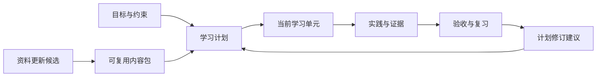

# 可进化、可复用的个人学习系统

设计草案 v0.1 · 2026-09-17 · 待评审，尚未开始系统实现

## 1. 产品定位与设计前提

设计一个长期使用的学习工作空间：把目标转化为能力要求，把能力要求转化为可执行任务，通过实践证据判断进展，再据此调整下一步。

首个内容领域是深度学习与大模型工程。系统的通用部分应支持以后加入分布式系统、数学、数据库等领域，而不需要重新开发一套产品。

已知条件：学习者已有实践经验，重点是大模型与工程，每周投入 10–15 小时，现有资料在 Windows 本地。用户已确认首先服务“个人、多领域复用”。多人协作和云同步保留演进空间，尚不作为首版要求。

当前可迁移资产已实际核对：

| 资产 | 现状 | 在新系统中的角色 |
|---|---|---|
| 深度学习与大模型工程手册 | 33 章 HTML | 概念解释、工程参考、诊断入口 |
| 高校课程目录 | 21 个课程条目 | 来源课程与课程版本 |
| 资料索引 | 349 个条目 | 资源、在线入口和访问状态 |
| 本地资料 | 323 份，约 2.44 GB；298 PDF、10 PY、15 Notebook | 不可变原件、阅读副本与引用来源 |
| 学习主线 | 11 阶段、48 个学习周 | 可复制、可调整的初始路线模板 |
| 阶段课件映射 | 53 次选用，涉及 50 份不同材料 | 首批精编学习单元的内容起点 |

上面的数量是现有资料清点结果，不表示学习者已完成任何任务。

设计成功的判断：打开系统后知道下一步做什么；做完后知道凭什么算通过；换领域或更新资料后，仍能保留并复用学习成果。

## 2. 三种形态与建议

| 形态 | 适合的需求 | 取舍 |
|---|---|---|
| 增强 HTML / 纯浏览器应用 | 阅读、简单打卡、便携查看 | 交付轻，但大量资料、可靠记录、备份和迁移需要额外设计；浏览器存储不能成为唯一副本 |
| **本地学习应用，优先推荐** | 单人长期使用、多领域、已有大量本地课件 | 数据可控、离线可用、容易接入现有文件；需要一次安装/启动及可恢复的备份流程 |
| 云端学习平台 | 多人、跨设备实时协作、集中教学管理 | 需要账号、权限、托管、费用和同步冲突设计；会显著增加首版范围 |

建议先采用第二种：本地网页界面 + 本地应用服务 + SQLite + 独立资料目录。后续可增加桌面外壳或同步服务，内容包格式与学习记录模型保持独立。

“本地优先”意味着离线仍可查看已导入资料、学习、记录和复盘。查找新资源、检查课程更新或调用远程 AI 时才需要联网。

SQLite 适合本地应用数据与低并发写入；若将来变为大量用户同时写入的共享服务，再评估服务端数据库。[SQLite 官方适用场景](https://www.sqlite.org/whentouse.html)

## 3. 核心结构：内容、记录、计划分别管理



**内容层**描述应该学什么：能力、先修关系、学习单元、资源、练习、验收规则和路线模板。它可以被不同目标、不同学习轮次使用。

**记录层**描述实际发生了什么：学习会话、笔记、尝试、产物、验收、反馈、复习和历史变更。它归属于具体学习者和学习轮次。

**计划层**描述接下来准备做什么：目标能力、当前缺口、每周预算、任务优先级、预计安排和调整原因。计划变化不会改写过去发生的事实。

例如：同一份 Attention 学习单元可以同时用于“大模型训练路线”和“多模态路线”。重复使用时共享原始资料，但不同项目的尝试、验收和进度分别保存。若旧证据适用于新目标，系统提出复用建议并说明条件。

## 4. 六个主要使用区域

| 区域 | 用户主要问题 | 关键内容 |
|---|---|---|
| 今日 | 现在做什么，为什么先做它？ | 继续上次学习、一个主任务、少量复习、可用时间与推荐理由 |
| 学习路径 | 要到哪里，哪些能力还缺？ | 阶段时间轴、先修依赖、必修/选修、预计与实际投入、可跳过依据 |
| 学习工作台 | 一边读，一边怎样形成理解？ | 课件阅读、概念解释、笔记、练习、实验产物、验收清单 |
| 资料与知识 | 资料在哪里，哪些是可信版本？ | 课程、PDF、代码、笔记、出处、版本、页码/单元定位、搜索 |
| 项目与证据 | 我能证明自己会什么？ | 项目里程碑、运行记录、指标、失败案例、验收反馈、能力证据 |
| 复盘与调整 | 哪里有效，下一周怎样改变？ | 计划偏差、耗时、卡点、回忆/迁移测试、带原因的计划修订 |

设置放在次要入口：学习预算、资料根目录、导入导出、备份、AI 提供方与可发送内容。

下面是“今日”的文字示意，所有进展均为示例：

```text
当前目标：大模型训练与工程能力
本周预算：12 小时      示例：已投入 4 小时

继续上次：Causal Attention 的 mask 检查
本次预计：60 分钟
完成标准：未来 token 改变时，更早位置输出不变
为什么推荐：这是进入 Decoder 训练单元的先修证据

今天只需完成
  1. 阅读已定位的课件片段
  2. 完成两个边界实验
  3. 关联结果，提交自评/验收

复习：解释 softmax 与交叉熵的关系，约 10 分钟
```

首页优先显示下一步和未解决问题；资料总量、学习时长、完成比例作为辅助信息。

## 5. 最小可复用单位：学习单元

把现有“大阶段”拆成通常可在 30–90 分钟推进的单元。复杂实验跨多个会话完成，工作量不强行切成相同长度。

一个单元至少包含：

| 字段 | 示例：Causal Attention 的正确性 |
|---|---|
| 目标能力 | 独立实现因果注意力并验证没有未来信息泄漏 |
| 先修 | 张量广播、矩阵乘法、softmax、序列训练目标 |
| 核心问题 | 为什么位置 t 不能使用位置 t+1 的信息？ |
| 主资源 | 指定版本的 CS224N/CS336 课件及手册章节 |
| 精确定位 | 经核对的 PDF 页范围、代码段或 Notebook 单元；未核对时明确只链接整份文件 |
| 动手任务 | 改变未来 token；构造 padding 边界；与参考实现比较 |
| 验收标准 | 输出隔离成立；mask 形状正确；容差、dtype、设备和输入范围有记录 |
| 失败诊断 | 检查 mask 方向、广播、softmax 维度、dropout 和容差 |
| 产物 | 代码链接、结果文件、结论与适用范围 |
| 后续连接 | Decoder 训练、KV cache、Attention 内核优化 |

资源多的单元也必须明确“先读哪一项、读到什么程度”。一份讲义可以支持多个单元，一个单元可以引用多门课的互补内容。

练习与验收标准有独立版本。正式课程的学术诚信与作业规则仍以官方规定为准；个人自学改编任务标明“自学练习”，避免与官方提交混淆。

## 6. 用证据描述掌握程度

阅读完成与能力验收分别记录。每项能力按四个维度积累证据：

| 维度 | 可接受的证据 |
|---|---|
| 理解 | 不看资料解释机制、推导关键关系、说明假设或反例 |
| 实现 | 独立完成实现，覆盖规定的正确性与边界检查 |
| 测量 | 设计公平基线、控制变量、报告误差/波动与资源消耗 |
| 迁移 | 在不同数据、规模、硬件或任务中应用，并解释失效条件 |

每个维度标为“尚无证据 / 正在尝试 / 待验收 / 在已记录条件下通过”。复习状态另行记录，不将“需要复习”误解成“过去的证据不存在”。

验收来源分开保存：本人自评、自动检查、AI 建议、人工复核。自动检查通过只证明检查范围内的行为；AI 判断不会直接变成已确认的掌握记录。

证据记录包括能力与规则版本、产物、环境、数据版本、关键指标、时间、评估来源和限制。文件内容变化或任务条件变化时，原证据保留，并提示是否需要重新验证。

系统可显示“主线必需能力 12 项，其中 4 项证据齐全”，但不将打开文件次数或模糊的综合 AI 分数包装成能力百分比。

## 7. 学习闭环与计划调整

完整闭环：

1. 选择目标模板，声明起点、每周时间、设备和需要交付的项目。
2. 做少量有区分度的诊断，确认已掌握能力与关键缺口。
3. 从路线模板创建一个学习实例，固定起始内容版本。
4. 根据先修、预算和当前卡点推荐一个可执行单元。
5. 阅读、实验、记录，提交产物并按规则验收。
6. 在后续会话中通过回忆、解释或迁移小题复查。
7. 每周提出计划调整，保留理由与变更历史。

推荐规则先做硬条件筛选：先修是否满足、资料是否可用、设备能否执行、当前时间是否足够。随后考虑目标相关性、当前项目阻塞、到期复习和预估工作量。用户固定的任务不会被自动替换。

**具体调整示例：**

| 观察到的情况 | 建议变化 | 保留的信息 |
|---|---|---|
| 已能独立完成梯度检查 | 缩短对应基础阅读，保留一次复核 | 原能力证据及采用该证据的原因 |
| Attention 两次因广播错误未通过 | 插入一个广播诊断单元 | 失败尝试、诊断依据和原计划 |
| 连续两周可用时间下降 | 降低后续周的计划负载、顺延可移动任务 | 已完成工作与固定里程碑 |
| 只有单 GPU | 先安排单卡正确性与内核实验 | 多 GPU 性能能力保持待验证 |
| 正确完成旧任务，但迁移题失败 | 增加迁移练习 | 原任务已通过的限定证据 |

前两周主要用于校准实际速度。时间估计以区间展示，随后根据用户实际会话更新；少量样本不足时明确低置信度。

复习首版采用可配置的简单规则：关键概念安排回忆检查、重要实现安排重做或迁移，答错后缩短间隔，稳定后延长。暂不宣称使用了经过个体校准的记忆模型。

“48 周路线”是模板。学习实例可以压缩、延长或分支，不因日历进入下一周就自动判定阶段完成。

## 8. “进化”具体发生在哪些地方

### 内容进化

新课件、新论文、链接失效或同 URL 文件变化进入更新候选。系统记录来源与检测时间，比较新增内容、先修变化和受影响的单元。

处理流程为“发现 → 校验 → 差异说明 → 接纳新版 → 必要时迁移学习计划”。旧版原件与引用仍可访问。更新检查是未来功能，本次设计不创建定时任务。

课程学期、课件封面日期、下载日期、内容修订日期分别保存。沿用已有材料的课堂年份不能自动变成材料创作年份。

### 学习策略进化

从耗时、失败原因、验收和复习结果生成计划修订建议。每条建议要说明原因、影响范围和可撤销方式。

初期先采用可解释的规则；当积累足够样本后，再评估是否引入统计估时或更复杂的推荐。系统不会因为一段聊天就擅自改变长期目标。

### 知识与作品进化

把笔记、错误解释、可重用实验和验证过的解决方法关联到能力节点。一次性能排查可以成为以后学习新框架时可复用的实验模板。

笔记保留草稿/已复核标记、证据来源和适用条件。后续结论推翻旧结论时建立替代关系，而不是静默覆盖历史。

### 软件本身的演进

通过版本化数据模型、稳定接口和可迁移内容包扩展。首版不设计“AI 自动修改系统代码并自行上线”的机制。

## 9. “复用”覆盖四个层次

| 层次 | 复用对象 | 需要隔离的内容 |
|---|---|---|
| 跨阶段 | 概念、课件、练习、实验规范 | 每次尝试与验收结果 |
| 跨目标 | 同一能力、同一学习单元 | 目标要求、项目条件和计划 |
| 跨领域 | 通用学习流程、证据模型、复盘规则 | 领域内容和专门的验收方式 |
| 跨设备或向他人提供模板 | 内容包与路线模板 | 个人笔记、凭证、学习记录默认不随模板导出 |

领域包采用声明式结构，包括主题、能力、先修边、单元、资源引用、验收模板与路线模板。首版不允许内容包携带自动执行代码；未来的代码测评器通过独立执行接口接入。

核心先修关系保持无环，导入时检查循环。可选参考、相似概念、替代资源不作为硬先修边，避免把学习路径锁死。

导出有三种形式：

- **学习模板包：**目标、路线、单元、规则和资源清单；可供另一个领域或用户参考。
- **个人完整备份：**内容版本、学习实例、记录、证据与所选资产；用于恢复或换机。
- **阅读快照：**HTML/Markdown，保留当前计划、笔记摘要与可访问链接；离开应用也能阅读。

教学资料原件是否进入可分享模板包取决于许可；默认模板只携带来源与校验信息，不因本地可下载就推定允许再分发。

## 10. 数据对象与版本规则

| 对象 | 作用与主要关系 |
|---|---|
| Domain / ContentPack | 领域及内容包，包含版本、依赖与来源 |
| Capability | 可验收能力，连接先修能力与目标等级/维度 |
| LearningUnit / UnitRevision | 单元与不可变修订版，引用能力、材料片段与规则 |
| Course / CourseEdition | 来源课程与学期版本，区别于个人路线 |
| Resource / ResourceVersion / Asset | 逻辑资源、版本及实际文件；多个引用可共享一个文件 |
| CurriculumTemplate / TemplateRevision | 推荐顺序、分支、预计工作量与目标能力 |
| LearningRun / PlanRevision | 某次目标实例与计划版本，引用确定的内容修订版 |
| Task / StudySession / Attempt | 计划任务、实际学习会话与多次尝试 |
| Artifact / Evidence / Assessment | 项目产物、支持的能力证据与验收判断 |
| Note / Review / ChangeProposal | 笔记、复习安排/结果与内容或计划修改建议 |

稳定 ID 与显示顺序分离。现有 c01、m002、r00 等编号导入为历史别名；未来新增资料或调整顺序不会重编所有引用。

文件使用内容校验值识别并去重。逻辑资源 URL 变化不等于文件变化，同 URL 文件变化则创建新资产版本。相同内容可以共享存储，但来源和版权说明分别保留。

笔记定位到资源版本与页/单元/片段。新版本分页变化时保留原定位，并提供重新关联建议；无法可靠匹配时标为待处理，避免落到错误页面。

SQLite 是学习状态和结构化元数据的主存储。用户编辑通过应用服务事务写入；JSON/Markdown 是交换与导出格式。搜索索引、缩略图、抽取文本和推荐缓存可重建，不作为唯一记录。

## 11. 技术结构建议

```text
用户界面
  今日 / 路线 / 工作台 / 资料 / 项目证据 / 复盘
                 │
本地应用服务：导入、查询、记录、验收、计划版本、备份
      ├── SQLite：元数据、学习实例、记录、变更历史
      ├── 资料目录：PDF、代码、Notebook、实验产物
      ├── 可重建索引：文本、检索、缩略图
      └── 可选适配器：AI 提供方、课程来源、将来的同步
```

技术选择遵循以下边界：

- 界面组件不包含课程专属流程，课程差异通过内容包和验收模板表达。
- 首版用一个本地服务组织业务，避免为单人产品拆分多个网络服务。
- 资料与记录存于用户可指定的位置，应用升级不重建或覆盖用户目录。
- 全文搜索可先用 SQLite FTS5；中文需要验证分词与召回策略，不能把默认英文式分词当作完整中文搜索。先实现标题、标签和笔记检索，再逐步抽取 PDF 正文。[FTS5 官方文档](https://www.sqlite.org/fts5.html)
- 图像型 PDF 明确标注“正文尚不可检索”，OCR 作为后续可选任务；不能静默将空抽取结果视为资料无内容。
- 先支持稳定的关键词与结构化筛选。语义检索在出现真实需求后增加，其索引仍可重建。
- 本地服务默认仅供本机访问，资料只能通过登记的资产位置打开；导入文件和外部页面按内容处理，不赋予执行权限。
- 第一版选定框架和依赖版本前做一次安装/打包验证；本草案不提前锁死前端框架、桌面外壳或模型供应商。

浏览器存储受配额和逐出策略影响，因此学习记录与约 2.44 GB 的原始资料不只放在浏览器缓存中。[MDN 存储配额与逐出说明](https://developer.mozilla.org/en-US/docs/Web/API/Storage_API/Storage_quotas_and_eviction_criteria)

## 12. AI 的职责与边界

AI 可协助解释指定材料、生成练习草稿、归纳卡点、检查报告遗漏、提出验收建议、比较新版课程和起草计划修订。每次输出要区分来源内容、推断和待确认信息。

基于资料回答时带资源版本与可核对定位；找不到支持时明确说明。首版不用 AI 独立认定能力，也不让它直接覆盖已经确认的学习计划或笔记。

没有 AI 接入时，核心学习、阅读、记录、验收清单、规则推荐与备份仍可使用。AI 提供方通过统一接口替换，模型、提示模板和检索范围记录在建议来源中。

使用远程 AI 前，用户能明确选择发送范围。默认不发送整个资料库或完整学习历史；密钥不进入内容包、日志或普通导出。离线模型可以作为另一个适配器，首版不承诺任意硬件都能运行。

对代码练习，首版关联外部运行结果，不自动运行任意课件/Notebook。未来需要自动测评时，再单独设计执行隔离、资源上限与网络策略。

## 13. 保存、备份与恢复

学习日志、笔记、验收和计划版本持久保存；显示已保存/未保存状态。关闭窗口后能继续上次单元与已保存草稿。浏览器 localStorage 最多保存界面偏好。

备份由一致性数据库快照、内容清单、资产清单及可选原件组成。不会简单复制正在写入的数据库文件来冒充一致性备份。大文件按校验值增量复用，备份保留可核对的完整清单。

数据模式升级有版本号，升级前生成恢复点；导入先预检 ID 冲突、版本依赖、文件校验和缺失资源，再在事务中提交。失败时不留下半条学习路线或部分进度。

首版必须有导出后恢复到干净目录的演练；“导出按钮成功”本身不等于已验证可恢复。

## 14. 现有内容如何迁入

第一步，读入已有课程 JSON、资料清单和路线数据；映射稳定 ID，保留 c/m/r 旧编号，核对文件、校验值、年份与访问状态。

第二步，建立资料目录引用。优先复用当前 323 份原件，不重复下载。阅读副本和正文抽取结果保持可重建。

第三步，把 11 阶段/48 周转成一个版本化路线模板；首版先精编前 2–3 个阶段的学习单元，后续阶段可维持阶段级任务和原课件入口，并明确细化程度。

第四步，从能力、产出、通过标准中整理首批能力与验收规则。自动提取仅产生草稿，人工核对先修与可验证性。

第五步，创建用户的第一个学习实例。初始进度由用户已有成果和诊断确定，不能从文件存在、页面打开或下载记录推断掌握。

验收：21 个课程、349 条索引、323 份本地资料和 11 阶段全部可追溯；原 HTML 继续作为阅读备份保留；新增的学习记录可以独立导出。

## 15. 分期建设与每期完成条件

| 阶段 | 范围 | 完成条件 |
|---|---|---|
| 设计确认 | 单人/共享定位、学习闭环、数据模型、首版边界 | 选择产品形态和首版主流程；未进入实现 |
| P0：走通一次真实学习 | 内容导入、今日任务、路线、资料阅读、笔记、任务/证据、人工验收、保存恢复 | 用一段真实学习任务走完“开始→实验→证据→验收→继续”，关闭重开不丢记录 |
| P1：形成可复用与可调整系统 | 路线模板、第二个领域包、规则推荐、每周复盘、计划版本、备份恢复 | 不改核心程序即可导入第二个领域；调整计划保留历史；完整恢复演练通过 |
| P2：内容与 AI 辅助进化 | 来源更新比较、建议审核、引用式答疑、练习草稿、检索增强 | 新版资料不破坏旧证据；AI 关闭时主流程可用；建议来源可追溯 |
| P3：按需要扩展 | 跨设备同步、模板分发、代码测评、多人 | 针对真实需求再设计冲突、身份、权限和执行环境 |

前 2–3 阶段精编单元之外的整条主线细化，可在真实使用反馈中分批完成。不把所有课件页数转成任务，不以一次性填满内容库作为首版完成条件。

目前未锁定实现工期。技术验证和首批单元试用后再估算，避免把资料体量直接转换成虚假的开发周期。

## 16. 第一版应验证的用户场景

1. 用户只有 45 分钟，能找到一个先修已满足、规模合适的任务，并理解推荐原因。
2. 从指定课件继续阅读，笔记关联正确资料版本；重开应用后仍能找回。
3. 一次任务失败，能保留尝试并记录诊断；补完缺口后重新验收。
4. 提交代码/实验产物后，有标准、有来源地记录结果，不因阅读完成而自动判定掌握。
5. 每周预算从 12 小时改成 8 小时，待办计划合理顺延，已完成证据保留。
6. 导入新的课程版本后，原笔记和验收仍可查看，用户知道哪些内容受影响。
7. 不接入 AI、不联网，仍能推进已经导入的任务。
8. 导出、恢复到干净目录后，路径、进度、笔记与证据一致。
9. 导入第二个领域内容包，沿用同一套学习与验收流程。

这些是未来实现的验收要求；本次尚未实现或运行这些场景。

## 17. 当前建议与待确认项

建议采用“本地优先、个人多领域、证据驱动、内容与学习记录分离”的方向。先完成 P0 的真实学习闭环，再推进 P1 的复用与自适应；把 AI 和自动更新作为随后接入的能力。

已确认的产品范围是个人多领域学习。当前需要评审的是本地应用形态、证据驱动的推进方式，以及 P0/P1 的建设边界。若未来转向多人教学/协作，再补账号、共享范围、验收角色和数据归属设计。

其它细节可在下一次评审按屏幕逐步确认：今日页与学习工作台的布局、首批学习单元粒度、首次诊断方式、备份位置与 AI 的默认接入方式。

本文件仅为设计产物。没有创建应用项目、迁移原件、改写现有学习指南、启动同步或自动更新任务。
